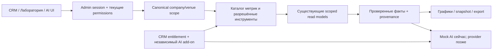

# SPACEVERSE — архитектура аналитики и будущего AI

Дата: 18 октября 2026. **Проект целевой архитектуры** поверх текущего кода, не описание уже работающей лаборатории/AI API. Текущие подтверждённые возможности — в [аудите](SAAS-PRODUCT-AUDIT.md).

## Опорные контракты

- Авторизация — существующие Admin sessions, permissions и canonical company/venue. Модель не задаёт scope. Запрошенные точки сверяются сервером с текущим доступом; иной tenant не подмешивается в общий отчёт.
- Onboarding/provisioning/runtime binding переиспользуются. Customer identity/ownership — миграции 017–020 и существующие repository/provisioner; не создаётся второй tenant registry и не присваиваются исторические legacy-аккаунты.
- Административный CRM adapter для новой компании ещё требуется. Контакт в CRM и подтверждённая личность в программе лояльности различаются; совпадение телефона/ника не разрешает автоматическую связку аккаунтов.
- Источник кассовых показателей — `pos/evotor-document.js`, `pos/repository.js`, `pos/analytics.js`, `admin-platform/server/evotor-read.ts`. Не добавлять второй независимый расчёт денег в React, отчётный builder или модель.
- Анонимные документы дают продажи, но не Customer 360/retention. Данные товаров ограничены чтением/аналитикой; склад и себестоимость производства не вычисляются.



## Семантический каталог метрик

У каждой записи: стабильный ID/schema version, смысл/единица, разрешённые роли/источники, population, time field/timezone, supported dimensions, aggregation/rounding, зависимости и причина unavailable. Клиент отправляет ID метрик и допустимые параметры, не SQL/table/column names.

| Показатель | Определение / источник | Ограничение |
|---|---|---|
| Продажи | `salesCents` существующего normalized SELL отчёта | Только разрешённый store и подтверждённые документы; не складывать с app subset |
| Возвраты | `returnsCents`, normalized PAYBACK | Сохранять связь/идемпотентность; знак для net задаёт общий расчёт |
| Чистая кассовая выручка | `netCents = salesCents - returnsCents` | Это не прибыль и не маржа; складской себестоимости нет |
| Чеки продажи | `receiptCount` из существующего summarizer | При неизвестном fiscal count значение null, число документов не подставляется вместо чеков |
| Средний чек продажи | Существующий `averageCents`: SELL total / известное число чеков, с текущим округлением | Возвраты не входят в denominator; при неизвестном count/нуле — unavailable |
| Привязанная выручка | `app` projection того же набора документов | Часть `all`, а не дополнительная выручка; анонимные чеки не создают клиентов |
| Доля привязанных продаж | Текущий `linkedRevenueSharePercent` по SELL | При нулевом SELL denominator — null; не заменять долей клиентов |
| Повторные покупатели | `app.repeatBuyers`, подтверждённые client links, несколько SELL documents за период | Текущее определение — покупки/документы, не физические визиты; явно подписывать population |
| Частота покупок | `app.purchaseFrequency` по существующему расчёту | Только linked subset и указанный период; не app DAU |
| RFM | Давность последней подтверждённой покупки, частота, сумма за зафиксированное окно | Новая версия определения; возвраты, окно и границы сегментов фиксируются; не угадывать анонимных клиентов |
| Retention | Доля зрелой когорты с повторной подтверждённой покупкой в заданном окне | Отдельно определить purchase cohort и registration cohort; незрелая/неполная история — null, не 0 |
| Наблюдаемый LTV | Накопленная подтверждённая net-выручка клиента за явно указанный горизонт | Не прогноз пожизненной прибыли. Прогноз требует отдельной модели/валидации |
| Визиты/воронка | Реальные последовательные события venue_visit/app activity и согласованная identity | При отсутствии событий график недоступен; покупки не заменяют посещения |
| Эффект кампании | Наблюдаемые доставки/отклики/связанные покупки; incremental lift отдельно | Корреляция и redemption не доказывают причинность; A/B требует достаточной выборки/рандомизации |

Minor units и quantities хранятся/суммируются без потери точности; текущие decimal-string/BigInt контракты сохраняются. Для нескольких точек нельзя усреднять средние: суммируются совместимые числители/denominators. Нельзя объединять валюты или бонусные кошельки разных заведений. Периоды — half-open UTC bounds, отображение/группировка в подтверждённой timezone. Сейчас кассовый контур использует Europe/Moscow; произвольные зоны не объявляются поддержанными без отдельного изменения.

## Качество данных как часть ответа

Предлагаемый response envelope содержит `schemaVersion`, серверный scope, период/timezone, `source`, `asOf`, coverage, freshness и status, metric definitions и reason codes. Точные HTTP/OpenAPI схемы публикуются вместе с исполняемой реализацией.

Различаются: подтверждённый пустой период (0), неподключённый источник (null), незавершённая синхронизация (null/явное ограничение), устаревший подтверждённый snapshot (stale), ошибка/отзыв доступа. При смене actor/company/venue старый snapshot немедленно исчезает из UI, даже если новая загрузка не закончилась. Ошибка доступа очищает данные. Повторная загрузка того же scope может сохранять предыдущий подтверждённый snapshot только с явной stale-маркировкой.

## Лаборатория и сохранение отчётов

1. Builder принимает allowlisted metrics/dimensions/filters, подтверждённый период и серверный набор точек. Ограничиваются диапазон, cardinality, число серий/строк, время и стоимость запроса. Большие запросы идут в scoped jobs с квотой.
2. Группировки: день/неделя/месяц/час, точка и подтверждённые товарные атрибуты. Категория не появляется, если провайдер передал только название/единицу товара. Воронки строятся только по настоящим событиям.
3. Line/bar/table — первый срез; pie/combo/heatmap/funnel подключаются по совместимости metric shape. Оси и суммы имеют единицы; пустые/неполные данные не превращаются в красивую выдуманную серию.
4. Формулы — ограниченный AST/DSL с типами единиц и whitelisted operations. Нет JS eval, SQL fragments, произвольных функций/таблиц. Permissions вычисляются по всем leaf metrics. Деление на ноль и несовместимые единицы отклоняются явно.
5. Saved dashboard definition хранит только спецификацию отчёта, schema version, canonical scope, владельца/разрешения и revision. Секреты/сырые customer datasets не входят в JSON. Новая нумерованная ручная Admin migration; optimistic concurrency и аудит.
6. Cache key включает текущий scope/permissions, source version/freshness, metric version и query. Результат другого tenant никогда не переиспользуется; отзыв доступа проверяется и при выдаче cache/export.
7. Drill-down до исходного документа снова проверяет права. Export — авторизованный snapshot с теми же определениями, лимитами и аудитом, TTL/retention по политике. CSV нейтрализует spreadsheet formula injection; XLSX использует типизированные значения; PDF не исполняет произвольный HTML/URL пользователя.

## Роли и коммерческие права

Готовится permission matrix владельца/управляющего/аналитика/сотрудника поверх существующих механизмов. Аналитик не получает write-доступ, ключи или общую выгрузку контактов только потому, что видит график. Права на метрики, детализацию и PII/export могут различаться.

CRM plan и AI add-on — независимые entitlements, связанные с canonical company/venue allocation. `admin_customer_entitlements` клиентских наград не переиспользуется как тариф. Лицензионный provider adapter вводится только после официального контракта Маркета; неподтверждённые права — default-deny. Expiry не удаляет клиентские данные; read/export/retention утверждаются отдельно.

## SPACEVERSE AI — без внешних расходов сейчас

### Provider interface и безопасные tools

Интерфейс провайдера должен нормализовать запрос, timeout/abort, structured result, usage и ошибки. Первая реализация допускает только тестовый adapter: `mode=synthetic`, `externalRequests=0`, реальная connection state остаётся `not_configured`, production AI flag выключен. Сам adapter/flag этим документом не создаётся, API ключи сейчас не нужны. Старый UI shell #101 изучается как материал для вопросов/UX, не объявляется работающим React AI.

Предлагаемая типовая граница (спецификация, не существующий модуль):

```ts
interface AiProvider {
  readonly kind: 'mock' | 'registered-provider'
  generate(input: {
    requestId: string
    question: string
    facts: AuthorizedMetricSnapshot[] // сформированы сервером, не JSON от модели
    maxOutputTokens: number
    signal: AbortSignal
  }): Promise<{
    schemaVersion: 1
    mode: 'synthetic' | 'provider'
    summary: string
    citedFacts: Array<{ snapshotId: string; metricId: string }>
    hypotheses: string[]
    limitations: string[]
    usage: { inputTokens: number | null; outputTokens: number | null }
  }>
}
```

`AuthorizedMetricSnapshot` имеет server-owned provenance/scope и проверяется инструментами; это не тип, которому доверяют после простого TypeScript cast запроса. Runtime schema validation обязательна. Mock детерминированно использует переданные факты и не выдаёт выдуманное число/прогноз; его token counts не доказывают расход реальной модели.

Будущие adapters выбираются из серверного registry поддерживаемых provider/model/HTTPS destinations. Пользователь не задаёт произвольный base URL. Credentials шифруются существующим server-side механизмом с purpose + canonical scope AAD, поддерживают rotation/revoke, никогда не возвращаются из GET и не пишутся в browser storage/logs. Ввод ключа в форме очищается после сохранения. Схема AI-конфигурации — отдельное additive extension, а не обход `provider='evotor'` старой таблицы.

AI получает разрешённые агрегаты/snapshots. Tools: получить каталог доступных метрик, выполнить ограниченный metric query, сравнить разрешённые периоды, описать полноту данных. Authoritative scope задаёт сервер вне model arguments. Контакты/прямые идентификаторы клиентов по умолчанию не передаются. Произвольный SQL, административные API, права, финансы и произвольный network fetch модели недоступны.

### Ответ и доказательства

Предлагаемая structured schema: summary, facts со ссылками на metric/snapshot ID, chart specification из разрешённого каталога, hypotheses/recommendations, limitations и usage state. Числа получаются из инструментов; ссылки должны разрешаться в доступные текущему пользователю факты. Неподтверждённые причинные объяснения маркируются гипотезами. Нельзя выдать успешный прогноз/связь при mock/недостаточных данных.

User text и customer content недоверенные, не меняют permissions. Ответ безопасно отображается без выполнения HTML. Будущая запись/автоматизация требует отдельного server-side allowlist, повторной проверки scope и явного human approval; финансовые операции не поручаются модели.

### Usage, лимиты и будущая себестоимость

До будущего billable запроса проверяются CRM entitlement, независимый AI add-on, feature flag, полномочия, активный credential и лимиты. Usage ledger хранит request ID, scope, provider/model, pricing version, reservations/status, reported tokens и оценку стоимости; ключей/PII в нём нет. Лимит резервируется атомарно, чтобы параллельные запросы не превышали бюджет.

Неизвестная цена/usage — null/unknown, не бесплатный запрос. Денежная оценка зависит от актуального тарифа/валюты провайдера. После неоднозначного timeout нет автоматического повторного платного вызова: состояние unknown/pending reconciliation. Synthetic tests имеют ноль внешних вызовов и не доказывают качество/цену реальной модели.

UI будущего модуля показывает состояние подготовки, доступные вопросы, источники/период, лимиты и отдельно preview на synthetic data. По умолчанию нет активного подключения/платного submit. Аномалии, прогнозы, weekly/monthly delivery и автогенерация сценариев — последующие этапы с quality/holdout/uncertainty tests, а не обещание текущего shell.

## Проверки и rollout

- SQL/HTTP: две компании, две точки одной компании, чужой/unowned customer, подмена scope, роль/revoke, snapshot/export после потери прав.
- Деньги/данные: closed/duplicate/out-of-order SELL/PAYBACK, 0 vs unavailable, unknown fiscal count, границы периода/timezone, negative net, linked subset без двойного сложения.
- Формулы/конструктор: AST limits, units, denominator zero, запрещённые dependencies/dimensions, query budget/cardinality.
- UI/E2E: delayed responses, actor/venue/customer switch, loading/error/stale, мобильные фильтры/таблицы, воспроизводимое сохранение dashboard.
- AI synthetic: запрет внешнего fetch/SQL, scope/prompt injection, schema/citation checks, отсутствующие данные, usage reservation races, revoked credentials, timeout/unknown accounting.
- Новые production-функции выключены по умолчанию. Приёмка каждого среза — реальные серверные проверки + применимый E2E; реальный provider/billing/Маркет проверяется отдельно после разрешённого доступа. Это не основание менять действующий бар или киоск.
